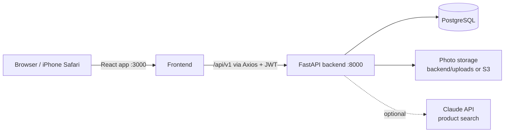

# ✦ Glow Journal — Skincare Tracker

A skincare progress journal. Take daily skin photos, tag the products you used, and track your journey by day number. You can follow other people's journeys, keep your own profile public or private (like Instagram), and make shareable before/after cards.

> ⚠️ Use **PowerShell**, not Command Prompt. All scripts are `.ps1`.

---

## Contents

- [Features](#features)
- [Tech stack](#tech-stack)
- [How the project works](#how-the-project-works)
- [Project structure](#project-structure)
- [Setup](#prerequisites)
- [Running the app](#running-the-app)
- [Using the app](#using-the-app)
- [Configuration](#configuration)
- [Troubleshooting](#troubleshooting)

---

## Features

| Feature | What it does |
|---|---|
| 📸 **Daily photo journal** | Take photos with the in-app camera, pick the best ones, and save them as a day in your journey |
| 🧴 **Product tagging** | Tag each entry with the products you used. Search about 90 seeded products (drugstore, K-beauty, J-beauty, sunscreens). If a product is missing, add it yourself, or let Claude AI find it when a key is configured |
| 📅 **Day tracking & milestones** | Day 1 is your first photo. Milestones unlock at days 7, 14, 30, 45, 60, 90, 180 and 365 |
| 🔍 **Explore** | Browse public journeys, filtered by product or skin concern |
| 👥 **Follow people** | Search users by username, follow them, and see their latest photos in a **Following** feed |
| 🔒 **Public / private profile** | Private accounts work like Instagram: followers have to be approved before they can see your photos |
| 🔗 **Progress cards** | Pick a day range (e.g. Day 30 → Day 60) to get a before/after card that shows the first and last photo with a big **"30 Day Progress"** headline. Download it or share it |

---

## Tech stack

### Backend (`backend/`)

| Technology | Used for |
|---|---|
| **Python 3.11** | Language. The pinned packages need 3.11 |
| **FastAPI** | The REST API (all routes under `/api/v1`), request validation, and auto-generated API docs at `/docs` |
| **Uvicorn** | The server that runs FastAPI. In development it auto-reloads when code changes |
| **PostgreSQL** | Database for users, journal entries, products, follows, follow requests, milestones and staged photos |
| **SQLAlchemy 2** | ORM. Tables are defined as Python classes in `models/models.py` and created at startup |
| **psycopg2** | PostgreSQL driver used by SQLAlchemy |
| **Pydantic / pydantic-settings** | Request and response schemas, plus loading settings from `.env.development` |
| **python-jose** | Creates and checks JWT login tokens |
| **passlib + bcrypt** | Hashes passwords. Plain passwords are never stored |
| **Pillow** | Makes the 400×400 thumbnails for uploaded photos |
| **boto3** (optional) | Saves photos to AWS S3 when `STORAGE_BACKEND=s3` |
| **Anthropic SDK** (optional) | AI product search with Claude when `ANTHROPIC_API_KEY` is set |
| **slowapi** | Rate limiting: login is limited to 10 tries a minute and sign-up to 5 a minute per IP, which slows down password guessing |

### Frontend (`frontend/`)

| Technology | Used for |
|---|---|
| **React 18** | The user interface: a single-page app with Journey, Explore and Profile tabs |
| **Create React App** (`react-scripts`) | Dev server, build tooling, and the dev proxy that forwards `/api` to the backend |
| **Axios** | HTTP calls to the backend (`src/services/api.js`). It attaches the login token to every request |
| **Zustand** | A small global store for the login token (`src/store/authStore.js`) |
| **html2canvas** | Turns the share card into a downloadable PNG |
| **Browser camera API** (`getUserMedia`) | The in-app camera. The 🖼 button falls back to the phone's own camera or photo library |

---

## How the project works



### 1. Sign up and log in
1. The user registers with a username, email and password. The backend hashes the password with bcrypt and saves the user.
2. The backend returns a **JWT token**, which the frontend keeps in `localStorage`.
3. Axios sends that token in the `Authorization` header on every API call. The backend uses it to know who is calling.

### 2. Adding a photo to the journal
```
Camera ──► POST /photos/capture ──► staged (temp_photos, expires in 24h)
                                         │
             choose photos, tag products, write a note, set public/private
                                         ▼
                         POST /photos/confirm ──► journal_entries
```
1. **Capture.** Each shutter press uploads the photo. The backend saves the original and a thumbnail, and records it as a *staged* photo.
2. **Review.** The user keeps or discards staged photos and tags products (see *Products* below).
3. **Confirm.** The chosen photos become journal entries with a **day number**: days since the user's first entry, plus one.
4. **Milestones** are checked each time the profile loads.

### 3. Following and privacy
| | Public profile | Private profile |
|---|---|---|
| Who sees name, bio and counts | Everyone | Everyone |
| Who sees photos | Everyone | Only approved followers |
| What **Follow** does | Follows right away | Sends a **follow request** that the owner confirms or deletes |
| Appears in Explore → Discover | Yes | No |

- Accepted follows are stored in `user_follows`. Pending requests are stored in `follow_requests`.
- Switching from private to public approves all pending requests automatically.
- The owner can remove a follower at any time, which takes away their access.
- An entry marked *not public* when it was saved is visible only to its owner, even to followers.

### 4. Products
```
type "cerave cleanser" ──► search database (every word must match the brand, name or category)
                              │
              found ──► tap to tag      not found ──► Claude AI search (only if a key is set)
                                                         │
                                       still missing ──► "+ Add product" form ──► saved & tagged
```
- **Seeded products** (`scripts/seed_products.py`) are marked *verified*. Re-running the script only adds products that are missing.
- **User-added products** are saved as *unverified* so they can be reviewed later. Products Claude finds are saved the same way.
- **No duplicates:** adding a brand + name that already exists (ignoring case and extra spaces) reuses the existing product.

### 5. Progress cards
- You choose a day range. The card shows the **first photo** in the range as *Before* and the **last photo** as *After*.
- The headline is the number of days between those two photos. Day 30 → Day 60 reads **"30 Day Progress"**, and Day 10 → Day 20 reads **"10 Day Progress"**.
- If you have no photo on the exact start or end day, the card uses the nearest photos inside the range, and the headline counts the days between the photos shown.
- You need photos on at least two different days in the range.
- The card also shows the products you used in that range (or the ones you pick) and your caption. It downloads as a PNG through html2canvas.

### 6. Explore
- **Discover:** public entries from public profiles, filterable by product or skin concern.
- **Following:** the latest entries from people you follow, including private accounts that approved you.
- **People:** search by username.

---

## Project structure

```
glow_journal/
├── backend/
│   ├── main.py               # FastAPI app: CORS, rate limiter, routers, /uploads static files
│   ├── config/settings.py    # Settings loaded from .env.development
│   ├── models/
│   │   ├── database.py       # DB engine and session
│   │   └── models.py         # Tables: User, JournalEntry, Product, FollowRequest, Milestone, TempPhoto
│   ├── middleware/auth.py    # Password hashing, JWT create/verify, current-user dependency
│   ├── routers/
│   │   ├── auth.py           # /auth/register, /auth/login
│   │   ├── photos.py         # capture → confirm, journal, delete
│   │   ├── products.py       # product search (DB + Claude), create product
│   │   ├── users.py          # profiles, follow / requests / followers, privacy, user search
│   │   ├── explore.py        # Discover feed and Following feed
│   │   └── share.py          # share-card data
│   ├── services/
│   │   ├── image_service.py  # save photos locally or to S3, thumbnails
│   │   └── ai_service.py     # Claude product search
│   ├── scripts/seed_products.py  # about 90 well-known products, safe to re-run
│   ├── scripts/seed_demo.py      # 5 demo profiles with progress photos for testing
│   ├── setup.ps1             # one-time setup
│   └── start-dev.ps1         # start the backend
└── frontend/
    └── src/
        ├── App.jsx           # Login screen, Journey / Explore / Profile tabs
        ├── components/
        │   ├── CameraCapture.jsx  # camera, staging, product tagging
        │   ├── ShareCard.jsx      # before/after share card
        │   └── Social.jsx         # user profiles, follow button, people search, follower lists
        ├── services/api.js   # every backend call
        └── store/authStore.js
```

---

## Prerequisites

| Tool | Version | Install |
|---|---|---|
| Python | **3.11** (3.12+ won't work with the pinned packages) | `winget install --id Python.Python.3.11 --scope user` |
| Node.js | LTS | https://nodejs.org |
| PostgreSQL | 18 | https://postgresql.org/download/windows (remember your password) |

Allow PowerShell scripts (once):
```powershell
Set-ExecutionPolicy -ExecutionPolicy RemoteSigned -Scope CurrentUser
```

---

## First-time setup

```powershell
cd backend
.\setup.ps1          # creates venv, installs packages, creates DB + .env.development, seeds products
cd ..\frontend
npm install
```

`setup.ps1` asks for your PostgreSQL port (default **5433**, which Windows installs often use instead of 5432) and password. It's safe to re-run.

To configure manually instead, copy `backend/.env.example` to `backend/.env.development` and fill it in.

---

## Running the app

Two PowerShell windows:

```powershell
# Window 1 — backend (http://localhost:8000, API docs at /docs)
cd backend
.\start-dev.ps1

# Window 2 — frontend (http://localhost:3000)
cd frontend
npm start
```

Open **http://localhost:3000**. Press `Ctrl+C` in each window to stop.

### On your iPhone (same Wi-Fi)

Stop the laptop servers first (they use the same ports), then:

```powershell
# Window 1
cd backend
.\start-dev-iphone.ps1

# Window 2
cd frontend
.\start-iphone.ps1
```

1. The frontend script prints your address. On the iPhone, open **`https://YOUR_LAPTOP_IP:3000`** in Safari. Note that it's `https`.
2. **First time only:** Safari warns *"This Connection Is Not Private"* because the dev certificate is self-signed. Tap **Show Details → visit this website**. If Windows asks whether Node.js may use the network, allow it.
3. Log in and use the app normally. The laptop also works at `https://localhost:3000`.

**How it works:** the phone talks only to the frontend dev server, which forwards `/api` and `/uploads` (photos) to the backend on the laptop. That avoids cross-origin problems, and photo links are stored as relative `/uploads/...` paths so they work on any device. HTTPS is needed because iPhone Safari only allows the live camera on secure pages. If the live camera still isn't available, tap **🖼** on the camera screen to take a photo or pick one from your library.

---

## Demo data for testing

```powershell
cd backend
$env:ENV_FILE=".env.development"; .\venv\Scripts\python.exe scripts\seed_demo.py
```

This creates 5 demo profiles that all follow each other. Each has illustrated progress photos (no real people) roughly every 3 days, with blemishes and redness fading over time, so the before/after cards show real progress.

| Username | Login email | Journey | Photos | Profile |
|---|---|---|---|---|
| `amara.glows` | amara@demo.example.com | 180 days | 61 | public |
| `jin.dewy` | jin@demo.example.com | 120 days | 41 | public |
| `sofia.clear` | sofia@demo.example.com | 90 days | 31 | **private** |
| `priya.calm` | priya@demo.example.com | 60 days | 21 | public |
| `leo.bright` | leo@demo.example.com | 30 days | 11 | public |

- Every demo account's password is **`Demo1234!`**.
- Running the script again replaces the demo data.
- The script refuses to run when `ENVIRONMENT=production`, because the demo password is public.
- `seed_demo.py --remove` deletes it.
- Your own accounts are never touched.

---

## Using the app

1. **Create an account.** Choose a username (3–30 letters, numbers, `.` or `_`), then enter your email and a password of at least 8 characters. You log in with your **email**.
2. **Take your first photo.** Tap 📸, take one or more photos (or tap 🖼 to pick from your library), keep the best, tag your products, and confirm. This is **Day 1**. If a product isn't in the list, tap **+ Add product**, enter the brand and name, and it's saved and tagged.
3. **Come back daily.** Each new photo is saved under its day number on the **Journey** tab. Tap ✕ on a photo to delete it.
4. **Explore:**
   - **Discover:** browse public journeys. Filter by product or concern, and tap a card to open that person's profile.
   - **People:** search by username, then tap **Follow**.
   - **Following:** see the latest photos from people you follow.
5. **Profile:**
   - Turn on **Private account** so only approved followers see your photos.
   - Open **Follow requests** to **Confirm** or **Delete** requests.
   - Tap **Followers** or **Following** to see the lists. You can **Remove** a follower.
   - Tap **Share My Progress**, pick a day range (e.g. 30 → 60), optionally choose products and a caption, then tap **Preview Card**. Save it as an image or share it.

---

## Configuration

The backend reads the env file named by `ENV_FILE` (default `.env.development`). Real environment variables override values in the file. See `backend/.env.example` for all settings.

| Setting | Notes |
|---|---|
| `DATABASE_URL` | PostgreSQL connection string |
| `SECRET_KEY` | Signs login tokens. `setup.ps1` generates a random one for each machine. With `ENVIRONMENT=production`, the app **refuses to start** unless this is a random value of 32+ characters. Generate one with `python -c "import secrets; print(secrets.token_hex(32))"` |
| `STORAGE_BACKEND` | `local` saves photos to `backend/uploads/`; `s3` uses AWS S3 |
| `ANTHROPIC_API_KEY` | Optional. Turns on AI product search. Without it, only seeded products are searchable |

Env files (`backend/.env.development`, `backend/.env.production`) and uploaded photos (`backend/uploads/`) are git-ignored. Never commit them.

---

## Branches

| Branch | Purpose |
|---|---|
| `main` | Stable code. Changes arrive here when a branch is ready |
| `dev_blue` | New app features |
| `dev_green` | Deployment work, so other people can use the app (hosting, Docker, CI/CD) |

---

## Troubleshooting

| Error | Fix |
|---|---|
| `No Python at '...Python311\python.exe'` | Python 3.11 was removed. Reinstall it, delete `backend\venv`, and re-run `.\setup.ps1` |
| `react-scripts not recognized` | `npm install` was interrupted. Run it again |
| `Connection refused port 5432` | Your PostgreSQL uses another port. Fix `DATABASE_URL` in `.env.development` |
| `DATABASE_URL Field required` | `.env.development` is missing. Run `.\setup.ps1` |
| `start-dev.ps1 is not digitally signed` | Windows marked the file as downloaded. Run `Unblock-File .\start-dev.ps1` (same for the other scripts) |
| Script blocked by PowerShell | `powershell -ExecutionPolicy Bypass -File .\setup.ps1` |
| Sent back to the login screen | Your saved login expired (logins last 30 days). The app signs you out automatically. Just log in again |
| `429 Too Many Requests` when logging in | More than 10 login attempts in a minute. Wait a minute |
| iPhone can't open the page | Use `https://` (not `http://`), make sure the phone is on the same Wi-Fi, and allow Node.js through Windows Firewall |
| iPhone camera shows "Live camera isn't available" | Tap **🖼** to use the phone's camera or photo library instead |
